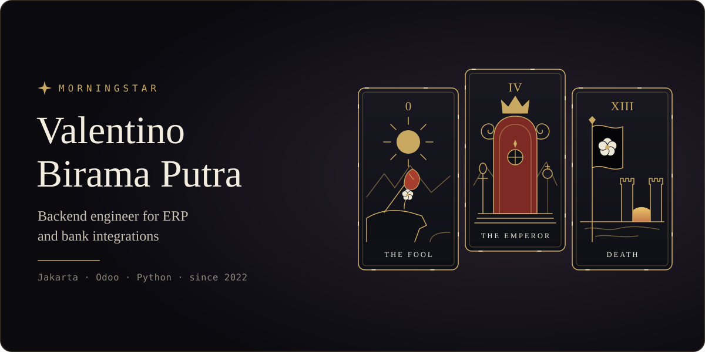

<p align="center">
  
</p>

<p align="center">
  <a href="EXPERIENCE.md"></a>
  <a href="PROJECTS.md"></a>
  <a href="TECH_STACK.md"></a>
  <a href="https://linkedin.com/in/valentinobiramaputra"></a>
</p>

<br />

```python
morningstar = Engineer(
    name="0x1uxifer",
    role="Backend Engineer, ERP Systems & Banking Integrations",
    based_in="Jakarta, Indonesia (UTC+07:00)",
    builds=["custom ERP System modules", "host-to-host banking", "approval workflows"],
    runs_on=["Python", "PostgreSQL", "RabbitMQ", "Docker"],
    exploring=["AI agents", "MCP", "machine learning"],
)
```

> **0 · The Fool: The Power of Becoming**
>
> Do you know what makes The Fool the most powerful card in Tarot? It's not that he knows where he's going. It's that he doesn't need to. He carries no burden of who he was, no fear of who he might become. He stands before the unknown, not as a man without wisdom, but as one who refuses to let the past define his future. He has nothing to prove, yet everything to become.

> **XIII · Death: The Art of Letting Go**
>
> Do you know what makes Death such a misunderstood card? It doesn't represent the end of life, but the end of what no longer deserves to live within you. Old identities, outdated beliefs, and versions of yourself you've long outgrown. Not everything is meant to follow you into the future. Sometimes, the greatest act of strength is knowing what must be left behind.

> **IV · The Emperor: The Weight of the Crown**
>
> Do you know what makes the Emperor powerful? It isn't the throne he sits upon, nor the authority he commands. It's his ability to govern himself before governing others. He understands that true leadership is not about demanding respect, but earning it through discipline, integrity, and responsibility. For a crown is not a symbol of privilege, but a reminder of the weight one must carry.
>
> A true king never needs to announce his sovereignty. Any man who must constantly remind others that he is king has already questioned his own authority. You think a crown makes you powerful? No. It is your judgment, your actions, and the burdens you are willing to bear that define you.
>
> He does not need to raise his voice to command a room, nor does he need to threaten to establish authority. Let others boast of their victories; he will let his legacy speak. And when the kingdom falls into chaos, he does not search for someone to blame. He takes responsibility.
>
> For a throne can be inherited, a crown can be stolen, and a kingdom can be conquered. But respect? That must be earned.
>
> **A king does not prove he wears the crown. He proves he deserves it.**

<br />

<h3 align="center">Three cards. One becoming.</h3>

<div align="center">

| Card | Lesson | Philosophy |
| :--- | :--- | :--- |
| **The Fool** | Beginning | The courage to become. |
| **Death** | Transformation | The courage to let go. |
| **The Emperor** | Mastery | The discipline to lead. |

</div>

<p align="center">
  <b>Begin without fear. Let go without regret. Lead without arrogance.</b>
</p>

<p align="center">
  <em>It was never about becoming a king in the eyes of others.<br />It was about becoming worthy of your own kingdom.</em>
</p>

<br />

## Experience

Building production ERP for a multi-company distribution group since 2022. **[Read the full experience →](EXPERIENCE.md)**

## Projects

An AI agent and mobile apps, built outside of work. **[See all projects →](PROJECTS.md)**

| Project | What it is | Built with |
| :--- | :--- | :--- |
| **Ghost** <sub>private</sub> | AI assistant with tools, document generation, market reports and an eval suite | `Python` `discord.py` `SQLite` `Docker` |
| **[Quran 2026](https://github.com/valentinodeenata/quran_2026_apps)** | Quran reader with a tajwid parser and per-ayah audio sync | `Flutter` `Dart` `GetX` |
| **[HabitFlow](https://github.com/valentinodeenata/HabitTracker-Flutter-Mobile-Apps)** | Habit tracking app that helps people build positive routines | `Flutter` `Dart` |

## Tech Stack

The tools I ship with, and the ones I'm learning. **[See the full tech stack →](TECH_STACK.md)**

     

<br />

<p align="center">
  <em>First, dare to become. Then, dare to let go. Finally, become someone worthy of the crown.</em><br /><br />
  <sub>THE FOOL · DEATH · THE EMPEROR</sub>
</p>
